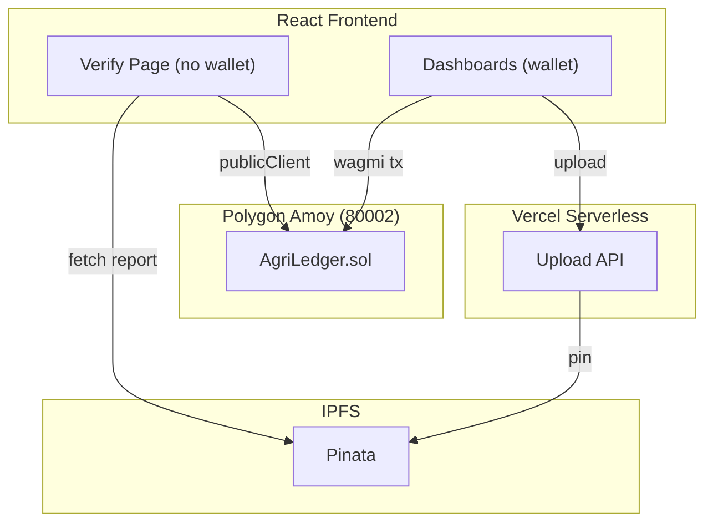

# 🌱 AgriLedger

**Know the field your food came from.**

Farm-to-Fork Transparent Organic Produce Provenance DApp — built for Hackathon PS-018 (Cybersecurity & Blockchain).

## Problem

Organic produce carries a **30–50% price premium**, incentivising fraud. Paper certificates are easily forged, and consumers have no verifiable proof of farm origin or pesticide-free lab testing.

## Solution

AgriLedger tracks organic produce through **3 milestones on the Polygon Amoy blockchain**:

1. **🌱 Harvest Log** — Farmer records crop details, GPS-tagged photo on IPFS
2. **🔬 Lab Certification** — Licensed lab uploads pesticide-free test report with keccak256 hash integrity
3. **📦 Hub Receipt** — Distributor confirms delivery at the distribution hub

Consumers **scan a QR code** on packaging to view the verified lifecycle — no wallet or login needed.

## Architecture



## Stack

| Layer | Technology |
|---|---|
| Smart Contract | Solidity ^0.8.24, OpenZeppelin v5, Hardhat |
| Chain | Polygon Amoy (chainId 80002) |
| Storage | IPFS via Pinata |
| Upload API | Vercel serverless function |
| Frontend | Vite + React + TypeScript, wagmi + viem |
| Design | "Botanical Archive" — warm paper, forest ink, specimen labels |

## Quick Start

```bash
# 1. Install dependencies
npm install
cd web && npm install && cd ..

# 2. Copy env and fill in values
cp .env.example .env

# 3. Compile and test the contract
npm run compile
npm test

# 4. Run the health check
npm run doctor

# 5. Start the frontend
cd web && npm run dev
```

## Test Results

- **70 tests passing** — full coverage of role access, state machine, input validation, revocation, pause mechanics, ETH rejection
- Target: 100% line and branch coverage

## Role Matrix

| Role | Can Do |
|---|---|
| Admin | Register/remove actors, pause/unpause, revoke batches |
| Farmer | Log harvests with photo + GPS + assigned lab |
| Lab | Certify batches (approve/reject) with report hash |
| Distributor | Record hub receipt for approved batches |
| Consumer | Scan QR, verify batch — **no wallet needed** |

## Stage Machine

```
Harvested → LabApproved → AtHub
         ↘ LabRejected
         
Any stage → Revoked (by admin or assigned lab)
```

## License

MIT
