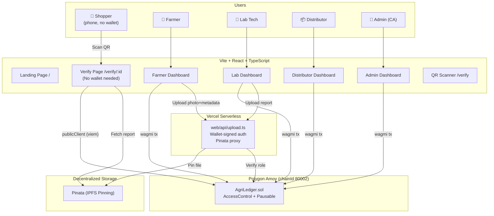

# AgriLedger — Full Analysis & Development Plan

> **Source:** [AGRILEDGER_MASTER_PROMPT_v2.md](file:///e:/agriledger/AGRILEDGER_MASTER_PROMPT_v2.md)  
> **Current state:** Empty repo (only the spec file exists)

---

## 1. What I Understood (Summary)

AgriLedger is a **Farm-to-Fork decentralized provenance DApp** for a 24-hour hackathon (PS-018, Domain: Cybersecurity & Blockchain). The core problem: organic produce carries a 30–50% premium, paper certificates are forgeable, and consumers have no verifiable proof of origin or lab testing.

The solution tracks **3 milestones** on an EVM testnet (Polygon Amoy): **Harvest Log → Lab Certification → Distribution Hub**. Four actors interact: **Farmers** log harvests with geotagged photos on IPFS; **Labs** upload pesticide-free test certificates to IPFS with keccak256 hash integrity; **Distributors** confirm hub receipt; **Admins** (Certification Authority) manage roles and revocations.

The standout feature is the **consumer verify page** — a phone-friendly, wallet-free page reached by QR scan that shows a plain-language verdict first, then proof. It re-computes keccak256 in-browser against the on-chain hash for document fingerprint verification.

The design system is "**Botanical Archive**" — warm paper, deep forest ink, ochre/clay status colours, herbarium specimen aesthetics. No crypto/neon/glass clichés. Judging is 40% contract+tests, 30% IPFS integration, 30% UI+consumer experience.

---

## 2. Architecture Overview

---

## 3. Component Breakdown

### 3.1 Smart Contract Layer (40% of Judging)

| Component | Details |
|---|---|
| **Contract** | `AgriLedger.sol` — Solidity ^0.8.24, OpenZeppelin v5 (`AccessControl`, `Pausable`) |
| **Roles** | `DEFAULT_ADMIN_ROLE`, `FARMER_ROLE`, `LAB_ROLE`, `DISTRIBUTOR_ROLE` |
| **State machine** | `Harvested → LabApproved/LabRejected → AtHub → Revoked` (Revoked from any non-revoked stage) |
| **Key structs** | `Batch`, `LabCert`, `HubEntry`, `Revocation` |
| **Core functions** | `registerActor`, `removeActor`, `logHarvest`, `certifyBatch`, `receiveAtHub`, `revokeBatch`, `pause/unpause` |
| **Views** | `getBatch`, `getLabCert`, `getHubEntry`, `getRevocation`, `getTimeline` (single RPC for consumer), `totalBatches`, `getBatchesByFarmer/Lab`, `stageCounts`, `getActors(role)` |
| **Custom errors** | 10+ custom errors (no require strings) |
| **Events** | `ActorRegistered`, `ActorRemoved`, `HarvestLogged`, `BatchCertified`, `ReceivedAtHub`, `BatchRevoked` |
| **Safety** | No ETH acceptance, no self-destruct, no upgradeability, no external calls |

### 3.2 Test Suite (Critical for 40%)

- **Target:** 100% line and branch coverage
- **~15+ test categories** covering: role access, input validation, stage machine transitions, revocation edge cases, pause mechanics, event arguments, `getTimeline` consistency, ETH rejection, gas reporting
- **Tools:** Hardhat + chai + ethers v6, `hardhat-gas-reporter`, `solidity-coverage`, optionally Slither

### 3.3 Scripts

| Script | Purpose |
|---|---|
| `deploy.ts` | Deploy, write `deployment.json`, copy ABI, attempt Polygonscan verification |
| `grant-roles.ts` | Register Farmer/Lab/Distributor from `.env` addresses |
| `seed.ts` | Create 5 demo batches (all states), generate demo PDFs with `pdf-lib`, pin to IPFS |
| `doctor.ts` | Health check: Node, `.env`, RPC, wallets funded, Pinata JWT, contract deployed, roles assigned |

### 3.4 Upload Service (30% of Judging — IPFS Integration)

- Vercel serverless at `web/api/upload.ts`
- Wallet-signed auth: client signs timestamped message, server recovers signer, checks on-chain role
- File validation (4 MB cap, MIME whitelist), rate limiting
- Returns `{ cid, size, name, gatewayUrl }`

### 3.5 Frontend (30% of Judging — UI)

**9 routes**, 4 require wallet, 4 are public + 404:

| Route | Key Components |
|---|---|
| `/` (Landing) | Hero, live SpecimenCard, problem strip, how-it-works, live stats, TrustExplainer, role cards, footer |
| `/verify` | QR scanner (camera) + manual batch ID entry |
| `/verify/:batchId` | **The hero page** — VerificationSeal, SpecimenCard, ProvenanceTimeline, IntegrityCheck, FarmMap, TrustExplainer |
| `/app` | Wallet connect, role detection, routing |
| `/app/farmer` | 3-step guided harvest form, batch list, QR generation |
| `/app/lab` | Pending/done batches, PDF upload, hash preview, Pass/Fail with confirmation |
| `/app/distributor` | Approved batches list, hub receipt |
| `/app/admin` | Actor management, pause toggle, batch revocation |
| `*` | Styled 404 |

**Signature Components (non-negotiable):**
1. `VerificationSeal` — 5-state circular stamp SVG with animation
2. `SpecimenCard` — herbarium-style batch label
3. `ProvenanceTimeline` — stem-based vertical timeline with draw animation
4. `IntegrityCheck` — document fingerprint comparison panel
5. `FarmMap` — sepia-tinted Leaflet map
6. `TrustExplainer` — honest two-column what-it-proves/what-it-can't
7. `QRCard` — print-ready QR with download

### 3.6 Design System: "Botanical Archive"

| Aspect | Spec |
|---|---|
| **Palette** | Paper (#F7F3EA), Surface (#FFFDF8), Forest (#1F4D2E primary), Harvest ochre, Clay red |
| **Fonts** | Fraunces (display), DM Sans (body), JetBrains Mono (hashes/addresses) — self-hosted |
| **Shape** | Cards r18, inputs/buttons r12, tags pill, seal circle |
| **Textures** | Paper grain (SVG feTurbulence), ledger rules, perforation dividers, hatch pattern (fail/recall) |
| **Motion** | Seal stamp-in, timeline stem draw, 150–250ms transitions, `prefers-reduced-motion` respected |
| **Accessibility** | WCAG 2.2 AA, ≥4.5:1 contrast, ≥48px touch targets, semantic HTML, skip link, aria-live |

### 3.7 Documentation

| Doc | Content |
|---|---|
| `README.md` | Problem, solution, architecture, URLs, setup, role matrix, coverage, gas, threat model, roadmap, screenshots |
| `docs/architecture.md` | Mermaid diagrams |
| `docs/DEMO_SCRIPT.md` | 3-minute demo walkthrough including attack scenarios |
| `docs/THREAT_MODEL.md` | What the system guarantees vs what it doesn't |

---

## 4. Phased Execution Plan

```mermaid
gantt
    title AgriLedger Development Phases
    dateFormat HH:mm
    axisFormat %H:%M
    
    section Phase 0 — Scaffold
    Scaffold repo, Hardhat + Vite + Tailwind :p0, 00:00, 1h
    
    section Phase 1 — Contract + Tests
    AgriLedger.sol + full test suite :p1, after p0, 5h
    
    section Phase 2 — Amoy Deploy
    Deploy, verify, grant-roles, doctor :p2, after p1, 2h
    
    section Phase 3 — Upload Service
    Pinata proxy + wallet auth :p3, after p2, 2h
    
    section Phase 4 — Design System
    Tokens, textures, fonts, UI primitives :p4, after p3, 2h
    
    section Phase 5 — Dashboards
    Portal, Farmer, Lab, Distributor, Admin :p5, after p4, 5h
    
    section Phase 6 — Consumer Pages
    Verify, Scanner, Landing, Mobile polish :p6, after p5, 4h
    
    section Phase 7 — Seed + Deploy Frontend
    seed.ts on Amoy, Vercel deploy :p7, after p6, 1h
    
    section Phase 8 — Docs + QA
    README, architecture, demo script, threat model :p8, after p7, 2h
```

### Parallelisation Opportunities

Once the **ABI exists** (after Phase 1 compiles), several streams can run in parallel:

| Stream A (Chain) | Stream B (Frontend Foundation) | Stream C (Upload Service) |
|---|---|---|
| Phase 2: Deploy to Amoy | Phase 4: Design system + UI primitives | Phase 3: Upload API |
| — | Phase 5+6: Dashboards + Consumer (stubbed) | — |

> [!TIP]
> Phases 3 and 4 are fully independent of each other — both can start as soon as the ABI is compiled in Phase 1. Phase 5 (dashboards) depends on both Phase 3 (upload) and Phase 4 (design system).

### Phase Details

#### Phase 0 — Scaffold (0–1h)
- Initialize Hardhat project with TypeScript
- Initialize Vite + React + TypeScript in `web/`
- Install all dependencies (wagmi, viem, react-router, tailwind, fonts, leaflet, qr libs, etc.)
- Create `.gitignore`, `.env.example` with all variables documented
- Configure Hardhat (Amoy network, gas reporter, coverage)
- Configure Vite + Tailwind with design tokens
- Verify `npx hardhat compile` and `npm run dev` work
- **Human Gates G1–G3** (tools, wallets, network)

#### Phase 1 — Smart Contract + Tests (1–6h)
- Write `contracts/AgriLedger.sol` with all structs, roles, functions, custom errors, events
- Write `test/AgriLedger.test.ts` with all ~15 test categories
- Target 100% line + branch coverage
- Run gas reporter
- Optionally run Slither
- ✅ All tests green, coverage ≥ 95%

#### Phase 2 — Amoy Deployment (6–8h)
- Write `scripts/deploy.ts` (writes `deployment.json`, copies ABI)
- Write `scripts/grant-roles.ts`
- Write `scripts/doctor.ts`
- Deploy to Amoy, attempt Polygonscan verification
- **Human Gates G4–G5** (test funds, explorer API key)
- ✅ Contract live on Amoy, `doctor` all PASS

#### Phase 3 — Upload Service (8–10h)
- Write `web/api/upload.ts` (Pinata proxy with wallet-signed auth)
- Write `lib/ipfs.ts` (gateway fallback chain)
- Write `lib/hash.ts` (keccak256 in browser)
- **Human Gate G6** (Pinata account + JWT)
- ✅ Test file pins and returns CID

#### Phase 4 — Design System (10–12h)
- `styles/tokens.css` — all CSS custom properties
- `styles/textures.css` — paper grain, ledger rules, perforation, hatch
- `styles/base.css` — reset, font loading, focus styles, skip link
- UI primitives: Button, Input, Select, Textarea, Card, Tag, Stat, Skeleton, Disclosure, Toast
- Signature components: `VerificationSeal` (5 states), `SpecimenCard`, `StageTag`, `AddressChip`
- Contrast check script
- `/_styleguide` dev route
- ✅ Screenshot review at 390/768/1280 px

#### Phase 5 — Dashboards (12–17h)
- `AppShell` with top bar, role badge, wallet chip
- `/app` — Portal with wallet connect + role detection
- `/app/farmer` — 3-step guided form (crop/date/lab → location/photo → review/sign), batch list, QR
- `/app/lab` — Pending/done tabs, PDF upload, hash preview, Pass/Fail confirm
- `/app/distributor` — Approved batches (multicall), hub receipt form
- `/app/admin` — Actor table, register form, remove, pause toggle, revoke form
- `TxStepper`, `RoleGuard`, error decoding (`lib/errors.ts`)
- ✅ Full lifecycle works on Amoy with 4 demo wallets

#### Phase 6 — Consumer Pages (17–21h)
- `/verify` — QR scanner + manual input
- `/verify/:batchId` — Full verify page with all 8 sections:
  1. Top bar
  2. Verdict block + VerificationSeal
  3. SpecimenCard
  4. ProvenanceTimeline
  5. Lab report + IntegrityCheck
  6. Farm photo
  7. Technical details (collapsed)
  8. Footer (share, report)
- `/` — Landing page (hero, problem strip, how-it-works, live stats, TrustExplainer, role cards, footer)
- `FarmMap`, `QRCard`, `TrustExplainer`
- Mobile polish + visual QA at 360/390/430 px
- ✅ All 5 status states reachable, works with no wallet

#### Phase 7 — Seed Data + Frontend Deploy (21–22h)
- Write `scripts/seed.ts` — generate demo PDFs with `pdf-lib`, pin to IPFS, create 5 batches
- Deploy frontend to Vercel
- **Human Gates G7–G8** (Vercel deploy, phone test)
- ✅ Public HTTPS URL, QR scans from phone

#### Phase 8 — Documentation + Final QA (22–24h)
- `README.md` with full content
- `docs/architecture.md` (mermaid diagrams)
- `docs/DEMO_SCRIPT.md` (3-minute script)
- `docs/THREAT_MODEL.md`
- Final QA checklist (Section 13)
- **Human Gate G9** (rehearsal)
- ✅ All checklist items ticked

---

## 5. Questions to Ask You First (Section 12)

1. **Team/project display name and tagline?** *Default: AgriLedger, "Know the field your food came from."*
2. **Region for demo farms and labs?** *Default: Sikkim, India*
3. **Do you already have: MetaMask installed, a Pinata account, a Vercel account, test POL?** *Default: No to all, guide me*
4. **Deploy on Vercel?** *Default: Yes*
5. **Will you present on a laptop plus a phone for the QR scan?** *Default: Yes*
6. **Preferred package manager?** *Default: npm*
7. **Do you want the EIP-712 stretch if time remains?** *Default: Yes, only after everything else*
8. **Any brand colours or a logo you must use?** *Default: No — use the forest/ochre/clay palette, typographic wordmark*

---

## 6. Human Gates — What I Need from You & When

| Gate | When | What You Do |
|---|---|---|
| **G1** Tools | Phase 0 start | Install Node 20+, Git, MetaMask extension + mobile app |
| **G2** Wallets | Phase 0 | Create 4 throwaway MetaMask accounts, paste addresses into `.env` |
| **G3** Network | Phase 0 | Add Polygon Amoy to MetaMask, get a free RPC (Alchemy) |
| **G4** Test funds | Phase 2 | Claim test POL from Amoy faucet for all 4 wallets |
| **G5** Explorer API key | Phase 2 | Create Polygonscan API key for contract verification |
| **G6** Pinata | Phase 3 | Create Pinata account, generate JWT, note gateway domain |
| **G7** Deploy app | Phase 7 | Create Vercel account, import repo, set env vars, deploy |
| **G8** Phone test | Phase 7 | Open verify page on phone, test QR scan + camera + integrity check |
| **G9** Final rehearsal | Phase 8 | Walk through full 3-min demo, confirm wallets funded |

---

## 7. Key Technical Decisions

| Decision | Choice | Rationale |
|---|---|---|
| **Tailwind version** | v4 (Vite plugin) preferred, v3.4 fallback | Spec preference; v4 uses `@theme` for design tokens |
| **Wallet library** | wagmi + viem | Spec mandated; modern, type-safe |
| **Connector** | Injected only (MetaMask) | Avoids WalletConnect project ID requirement |
| **Consumer page RPC** | viem `publicClient` (no wallet) | Critical — shoppers must not need MetaMask |
| **IPFS gateway fallback** | Pinata dedicated → gateway.pinata.cloud → ipfs.io | Resilience for the integrity check |
| **Hash algorithm** | keccak256 (viem) | Match on-chain Solidity keccak256 |
| **QR encoding** | Full verify URL | "Dynamic" because page reads live chain state |
| **Forms** | react-hook-form + zod | Spec mandated; strong validation |
| **Map** | react-leaflet + OSM | Free, spec mandated, with sepia CSS tint |

---

## 8. Risk Assessment

| Risk | Likelihood | Impact | Mitigation |
|---|---|---|---|
| Amoy faucet down/rate-limited | Medium | High (blocks Phase 2+) | Research multiple faucets upfront; have backup POL |
| Pinata rate limits on free tier | Low | Medium | Upload service has rate limiter; seed script pins in sequence |
| Polygonscan verification fails | Medium | Low | Manual fallback documented; not a blocker |
| IPFS gateway slow on demo day | Medium | Medium | 3 gateway fallbacks; chain data renders first; backup screenshots |
| Tailwind v4 breaking changes | Low | Medium | Fallback to v3.4 is acceptable per spec |
| Time pressure (24h) | High | High | Cut in order: EIP-712 → map → admin UI (replace with script) → landing extras |

> [!IMPORTANT]
> **Never cut:** tests, the on-chain/off-chain hash integrity check, or the consumer verify page. These are the scoring core.

---

## 9. Priority Cut Order (if time runs short)

1. ~~EIP-712 stretch~~ (first to go)
2. ~~FarmMap~~ (replace with coordinates display)
3. ~~Admin UI~~ (replace with `scripts/grant-roles.ts`)
4. ~~Landing page extras~~ (keep hero + verify entry)
5. **NEVER CUT:** Tests, IntegrityCheck, Consumer verify page

---

## 10. File Count Estimate

| Area | Files | Lines (est.) |
|---|---|---|
| Smart contract | 1 | ~350 |
| Tests | 1 | ~600 |
| Scripts | 4 | ~400 |
| Config (Hardhat, Vite, Tailwind, env) | 6 | ~200 |
| Upload API | 1 | ~120 |
| Frontend libs | 5 | ~300 |
| Frontend hooks | 5+ | ~400 |
| Design system (CSS) | 3 | ~300 |
| UI components | 12+ | ~1200 |
| Signature components | 7 | ~1000 |
| Pages | 9 | ~1500 |
| Documentation | 4 | ~500 |
| **Total** | **~58 files** | **~6,870 lines** |

---

> [!NOTE]
> **Next step:** Answer the 8 questions above (or say "use defaults"), and I'll begin Phase 0 — scaffolding the complete project immediately.
